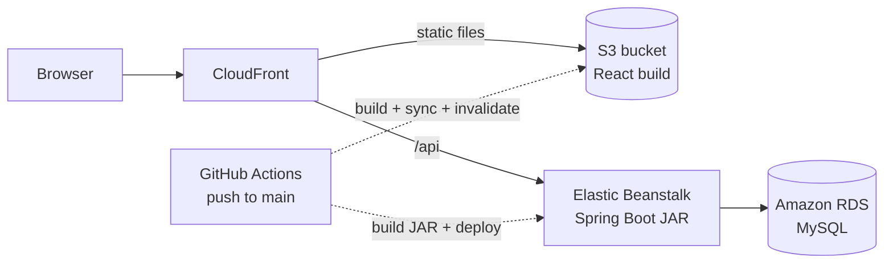

# Cliché Piggy Bank

A small full-stack web app for a team game: whoever uses an empty phrase gets a "fine" from a colleague, and the fines pile up in a shared digital piggy bank. Users can fine each other (with a reason), see everyone's balance, like the funniest reasons, and an admin settles the accounts when the real money has been paid.

It started as a take-home exercise (a JSON-file backend) and grew into a learning project: I moved persistence to MySQL, built a React frontend, and set up automated deployment on AWS.

**Live demo (acceptance environment):** https://d2p6n1km64ehhh.cloudfront.net/

## Tech stack

| Layer | Technology |
|---|---|
| Backend | Java 25, Spring Boot 4.1, Spring Web, Spring Data JPA (Hibernate), Gradle |
| Database | MySQL (Amazon RDS in the cloud) |
| Frontend | React 19, TypeScript, Vite, React Router, Axios |
| Tests | JUnit 5, Spring MockMvc (`@WebMvcTest`), Mockito, JaCoCo coverage report |
| Delivery | GitHub Actions |
| Hosting | AWS: Elastic Beanstalk (API), RDS for MySQL, S3 + CloudFront (frontend) |

## Architecture



- The **frontend** is built by Vite with environment-specific settings (`.env.development`, `.env.acceptance`), uploaded to S3, and served through CloudFront. The pipeline invalidates the CloudFront cache after every deployment.
- The **backend** is a stateless REST API. Configuration (datasource, CORS origins) comes from environment variables, with defaults in `application.properties`.
- **Deployments** run automatically on every push to `main`, with separate workflows for backend and frontend (`.github/workflows/`).

## Domain model

| Entity | Purpose |
|---|---|
| `User` | A team member |
| `Role` | `user` or `admin`; a user can have both. Stored as its own entity |
| `Sanction` | A fine from one user to another, with amount, free-text reason, timestamp and like counter |
| `Account` | The balance owed by one user, created automatically with the first sanction |
| `Like` | One like per user per sanction (enforced by a unique constraint) |

Sanction amounts are `LOW` (0.50), `STANDARD` (1.00) and `HIGH` (2.00).

## Features and rules

- Any user can fine another user; the amount is added to the receiver's account.
- The newest sanctions are listed first; the list is paginated and can be sorted by date or by number of likes.
- Users can like and unlike a sanction, once per sanction.
- Admins can create users, delete users, and reset an account to zero after the real payment.
- A user with an outstanding balance cannot be deleted.
- The very first registered user automatically becomes user and admin; after that, `/register` is closed and only admins can add people.

## REST API

All endpoints live under `/api`. The acting user is passed as the query parameter `inquirerid` (see *Known limitations*).

| Method | Path | Description |
|---|---|---|
| `POST` | `/users/register` | Create the first user (user + admin). Only works while no users exist |
| `GET` | `/users`, `/users/{id}` | List users / get one user |
| `POST` | `/users` | Create a user (admin only) |
| `DELETE` | `/users/{id}` | Delete a user with a zero balance (admin only) |
| `GET` | `/accounts`, `/accounts/{id}` | List accounts / get one account |
| `PUT` | `/accounts/{id}/reset` | Reset a balance to 0 (admin only) |
| `POST` | `/sanctions` | Fine a user |
| `GET` | `/sanctions` | Paginated list (`page`, `size`, `sort=datetime\|likes`, `order=asc\|desc`) |
| `GET` | `/sanctions/{id}` | Get one sanction |
| `POST` / `DELETE` | `/sanctions/{id}/like` | Like / remove your like |

Errors are returned as JSON (`status`, `error`, `message`) by a central exception handler. A Postman collection is included: `ClichePiggyBank.postman_collection.json`.

## Running locally

**Requirements:** JDK 25, Node.js 20+, and MySQL 8 (Community Edition).

1. Install MySQL locally and create the database. By default the app connects as `root` with password `secret` (override with the environment variables below). Hibernate creates the tables on first start.

   ```sql
   CREATE DATABASE user_db;
   ```

2. Start the backend (listens on port 8080):

   ```bash
   ./gradlew bootRun
   ```

   Override the defaults with `SPRING_DATASOURCE_URL`, `SPRING_DATASOURCE_USERNAME`, `SPRING_DATASOURCE_PASSWORD` and `APP_CORS_ALLOWED-ORIGINS`.

3. Start the frontend (http://localhost:5173):

   ```bash
   cd frontend
   npm install
   npm run dev
   ```

4. Open the app, register the first user, then add more users and start fining.

## Tests

```bash
./gradlew test
```

The controller tests mock the repositories and cover the main flows and error cases for users, accounts and sanctions. The application-context test needs the local MySQL database from step 1. A coverage report is written to `build/reports/jacoco/test/html/index.html`.

## Known limitations and next steps

I'm listing these deliberately; they are the next things I would change.

- **No real authentication yet (planned).** The acting user is identified by an ID in the query string, and "login" in the UI just selects a user. This is enough for a trusted-team demo but not for production. Next step: Spring Security with JWT or AWS Cognito.
- **Pipeline.** Tests should run in CI before every deployment, and AWS access should move from stored keys to GitHub OIDC.
- **Frontend tests** are still missing.

## License

Apache License 2.0, see [LICENSE](LICENSE).
